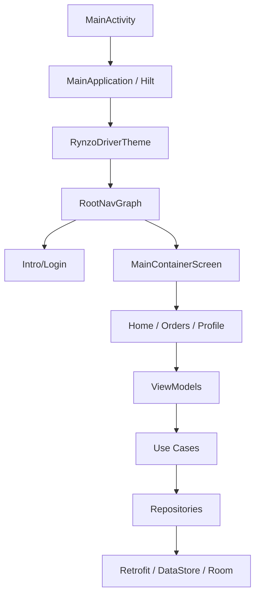

# Rynzo Driver — Kotlin Source Documentation

**Scope:** 68 Kotlin files under `app/src/main/java/com/example/rynzodriver`.

## Architecture

The project follows MVVM plus use-case/repository separation:

- **UI:** Jetpack Compose screens and composables.
- **ViewModels:** Hold `StateFlow` state and launch coroutines.
- **Domain:** Models, repository interfaces, and use cases.
- **Data:** Retrofit APIs, DTOs, repository implementations, DataStore, Room, and WebSocket.
- **DI:** Hilt modules provide dependencies.

## Kotlin and Android glossary

- `package` / `import`: Organize code and make declarations available.
- `class`: Defines a type; `object` declares a singleton; `data class` stores data and generates `copy`, `toString`, `equals`, and `hashCode`.
- `interface`: A contract implementations must satisfy. `sealed class/interface`: A closed set of related types.
- `fun`: Defines a function. `suspend`: Allows suspension in a coroutine. `operator fun invoke`: Allows calling an object like a function.
- `val`: Read-only. `var`: Mutable. `private`: Restricted scope. `override`: Replaces a base implementation.
- `@Composable`: A function that declares Compose UI. `@HiltViewModel`: Injected ViewModel. `@Inject`: Dependency to Hilt.
- `?` / `?.` / `?:` / `!!`: Nullable type, safe call, fallback/default, and forced non-null assertion.
- `when`: Multi-condition branching. `let`, `apply`, `also`: Scoped helper functions.
- `map`, `forEach`, `firstOrNull`, `getOrNull`: Collection transformation and safe access helpers.
- `StateFlow` / `SharedFlow` / `Flow`: Observable asynchronous state or events.
- `viewModelScope`: Coroutine scope cancelled with a ViewModel. `LaunchedEffect`: Compose side effect tied to keys.
- `Modifier`: Controls Compose size, padding, appearance, and interactions.

---

# Entry point

## `MainActivity.kt`

- `MainActivity` extends `ComponentActivity`.
- `onCreate` enables edge-to-edge display and calls `setContent`.
- `RynzoDriverTheme` supplies Material colors/typography; `RootNavGraph` supplies navigation/UI.
- Used concepts: inheritance, `override`, annotations, Composable lambda.

## `MainApplication.kt`

- Extends `Application` and declares `@HiltAndroidApp`.
- Hilt initializes the application dependency graph when Android starts the app.

# Utilities

## `util/MapRouteUtils.kt`

- Imports Google `LatLng`.
- Defines `MapRoute` and `DEFAULT_MAP_CENTER`; `isValid` verifies that route points exist.
- `buildRoutePoints` creates synthetic pickup/dropoff points with `mapIndexed`.
- `buildMapRoute` combines points and fallback stop names.

## `util/ToastService.kt`

- Singleton injected application `Context` service.
- `showToast` creates and displays an Android Toast; default duration is short.

## `util/ContextExt.kt`

- Adds `Context.hasLocationPermission()`.
- Requires both fine and coarse location permissions and returns `true` only when both are granted.

# Navigation

## `ui/navigation/NavRoutes.kt`

- Defines `Screen` sealed routes and `BottomBarScreen` destinations.
- `createRoute` replaces placeholders and URI-encodes titles, labels, and stop lists.
- Company-trip routes use `||` as a stop separator and `none` for an absent driver ID.

## `ui/navigation/RootNavGraph.kt`

- Collects `MainViewModel.authState`.
- Shows no UI while auth is loading; chooses Main or Intro for the start destination.
- `LaunchedEffect` responds to authentication changes and clears the appropriate back stack.
- Registers Intro, Login, and Main destination screens.

# Main application UI

## `ui/main/MainViewModel.kt`

- Exposes `AuthState.Loading/Authenticated/Unauthenticated` as `StateFlow`.
- On initialization, validates session values and clears them if invalid.
- Collects `isLoggedIn` and updates auth state.

## `ui/main/MainContainerScreen.kt`

- Creates nested navigation and a `Scaffold` with bottom navigation.
- Bottom items navigate using route, restore/save state, and avoid duplicate top destinations.
- Registers Home, Orders, Profile, generic trip detail, and company-trip detail routes.
- Decodes URI route arguments and splits company-trip stop strings.

# Intro, login, and profile

## `ui/intro/IntroScreen.kt`

- Uses `Box` and `Column` for branding and a continue button.
- Calls `onContinue` when the Continue button is pressed.

## `ui/login/LoginScreen.kt`

- Holds mobile/password `remember` state.
- Collects LoginViewModel state with `collectAsState`.
- `LaunchedEffect` navigates after successful login and resets state.
- `UberTextField` wraps `OutlinedTextField` with keyboard and visual transformations.

## `ui/login/LoginViewModel.kt`

- Validates blank credentials; updates UI state and Toast on failure.
- `submitCredentials` runs `LoginUseCase` in `viewModelScope`.
- Success/failure/loading states are exposed through `StateFlow`; `resetState` restores defaults.

## `ui/profile/ProfileScreen.kt`

- Placeholder screen centered in a full-size `Box`.

# Home dashboard

## `ui/home/HomeScreen.kt`

- Requests permissions and collects home/location state.
- Handles trip navigation events and consumes them after navigation.
- Starts/stops `LocationService` according to duty state and active vehicle/permission/GPS checks.
- Displays `TopSection`, `RequestedTripsSection`, `CompanyTripsSection`, and a vehicle bottom sheet.
- Service Intents use `ACTION_START/ACTION_STOP` and pass the vehicle ID as an extra.

## `ui/home/HomeViewModel.kt`

- Holds vehicles, duty state, active-trip state, company trips, sheet state, and navigation events.
- Loads data at initialization and fetches active trip status and vehicles.
- Converts company-trip DTOs to UI models.
- Prevents vehicle/duty changes during an active trip.
- `selectedVehicle` falls back to the first vehicle.

## `ui/home/TopSection.kt`

- Displays app name, notification/avatar controls, greeting, online switch, vehicle selector, and location.
- Collects `HomeViewModel.uiState`.
- Formats vehicle model/number or an ID prefix.
- Disables trip-sensitive controls when an active trip exists.

# Trip UI

## `ui/trips/RequestedTripsCard.kt`

- Contains `RequestedTripsCard`, route spine, route stop row, and `RequestedTripsSection`.
- Formats trip type/status and displays customer and route information.
- Uses `LazyRow`; loading/error/empty states are explicit.

## `ui/trips/RequestedTripDetailedView.kt`

- Loads a trip on `LaunchedEffect(tripId)`.
- Uses a Google Map with markers/polyline and a scrollable bottom sheet.
- Fits map bounds for multiple stops or zooms for one stop.
- Supports route expansion, reject, and accept operations.

## `ui/trips/TripRequestsViewModel.kt`

- Holds trip-list/detail/loading/error/accepting state.
- Fetches requests/details and accepts trips using use cases.
- Updates state through immutable `copy` calls and invokes success callbacks.

## `ui/trips/TripRequestsScreen.kt`

- Scaffolded full-screen trip list using `LazyColumn`.
- Handles loading, error/retry, empty, and populated states.
- Item selection creates a trip-detail navigation route.

# Company-trip UI

## `ui/companyTrips/CompanyTripDetailScreen.kt`

- Contains detail ViewModel state and Compose detail/map UI.
- Starts company runs through `ApiService.startCompanyRun`.
- Builds fallback route points and fits map bounds with a `LatLngBounds.Builder`.
- Displays success/error messages and handles loading on the Start button.

## `ui/companyTrips/CompanyTripsSection.kt`

- `toUiModel` converts API DTO fields to display title, vehicle label, route ID, and stop names.
- `CompanyTripsSection` renders loading/error/empty/horizontal cards.
- `CompanyTripCard` and `CompanyStopRow` provide route and vehicle presentation.

# Theme

## `ui/theme/Theme.kt`

- Defines static light/dark Material3 schemes and `RynzoDriverTheme`.
- Android 12+ can use dynamic system colors; older/static paths use app schemes.

## `ui/theme/Color.kt`

- Declares Uber-style black, white, blue, green, grey, and dark-grey values.

## `ui/theme/Type.kt`

- Loads Inter font resources and defines `Typography` styles.

# Permissions

## `ui/permissions/PermissionManager.kt`

- Requests camera, fine location, and coarse location permissions once on composition.
- For Android 10+, separately requests background location permission.

# Domain models

## `domain/model/User.kt`

- Immutable domain user containing identity, role, and token.

## `domain/model/trips/Trip.kt`

- Defines `Trip`, `Stop`, and `StopType(PICKUP, DROP, UNKNOWN)`.

## `domain/model/trips/TripDetails.kt`

- Empty placeholder source file.

## `domain/model/trips/TripDetail.kt`

- Full trip domain details including customer, driver, vehicle, status, and stops.

# Domain repository interfaces

## `domain/repository/auth/AuthRepository.kt`

- Contracts login, refresh, and `isLoggedIn` operations.

## `domain/repository/trips/TripRepository.kt`

- Contracts trip-list, trip-detail, and accept operations.

## `domain/repository/websocket/WebSocketRepository.kt`

- Contracts connection state, incoming messages, connect/send/disconnect operations.

# Domain use cases

## `domain/usecase/LoginUseCase.kt`

- Calls `AuthRepository.login`; invoked as `loginUseCase(mobile, password)`.

## `domain/usecase/trips/GetTripRequestsUseCase.kt`

- Calls repository and returns `Result<List<Trip>>`.

## `domain/usecase/trips/GetTripDetailsUseCase.kt`

- Loads one trip ID and returns `Result<TripDetail>`.

## `domain/usecase/trips/AcceptTripRequestUseCase.kt`

- Accepts a trip ID and returns a result message.

# HTTP APIs

## `data/api/ApiService.kt`

- Defines profile, active-trip, vehicle, company-trip, and company-run endpoints.

## `data/api/AuthInterceptor.kt`

- Reads access token and inserts `Authorization: Bearer <token>` into OkHttp requests.

## `data/api/auth/AuthApiService.kt`

- Retrofit login and refresh endpoints.

## `data/api/trips/TripApiService.kt`

- Retrofit trip-list, detail, and accept endpoints.

# DTOs

## `data/dto/auth/LoginRequest.kt`

- Gson login request mapping mobile/password to API JSON names.

## `data/dto/auth/LoginResponse.kt`

- Login, user, token, refresh-request, and refresh-response DTOs.

## `data/dto/LocationUpdateDto.kt`

- Serializable vehicle-location payload containing type, vehicle ID, coordinates, and time.

## `data/dto/vehicles/DriverVehicleDto.kt`

- Vehicle, profile, active-trip, location, and response DTOs.

## `data/dto/company/CompanyTripDto.kt`

- Company route, vehicle, recipient, stop, run-request, and run-response DTOs.

## `data/dto/trips/TripAcceptResponse.kt`

- Trip-accept success/message/data response.

## `data/dto/trips/ParticularTripResponse.kt`

- Detailed trip response, customer/driver/vehicle nested DTOs.

## `data/dto/trips/TripDto.kt`

- Trip summary/list, stops, coordinates, creator, and recipient metadata DTOs.

# Local persistence

## `data/local/DataStoreManager.kt`

- Stores auth fields in Preferences DataStore.
- Exposes `isLoggedIn`, access/refresh/user flows, session validation, updates, and clear operation.

## `data/local/db/entity/LocationEntity.kt`

- Room entity storing coordinates, timestamps, IDs, and sync state.

## `data/local/db/dao/LocationDao.kt`

- Room insert/query/update/delete operations for location persistence.

## `data/local/db/AppDatabase.kt`

- Defines Room database version 1 and provides `LocationDao`.

# Location tracking

## `data/location/LocationClient.kt`

- Interface for location update Flows and nested `LocationException`.

## `data/location/LocationTrackingState.kt`

- Singleton `StateFlow` holding current/last formatted location strings.

## `data/location/LocationService.kt`

- Foreground Android Service that collects GPS updates, sends WebSocket location JSON, refreshes tokens, and manages notifications.
- `onStartCommand` handles start/stop actions; `onDestroy` cancels its coroutine scope.

## `data/location/DefaultLocationClient.kt`

- Implements fused-location updates using callbackFlow.
- Validates permissions/GPS, requests 10-second updates, and removes callbacks when collection ends.
- `requestLocationSettingsResolution` launches required GPS settings when resolvable.

# WebSocket

## `data/websocket/WebSocketState.kt`

- Sealed state: `Disconnected`, `Connecting`, `Connected`, or `Error(Throwable)`.

## `data/websocket/WebSocketManager.kt`

- Singleton OkHttp WebSocket manager.
- Exposes connection and incoming-message Flows, connects, sends text, disconnects, and maps listener events to state.

# Repositories

## `data/repository/auth/AuthRepositoryImpl.kt`

- Implements login, refresh, and login-state operations with API/DataStore.
- Converts API DTOs to domain `User` and returns `Result` values.

## `data/repository/trips/TripRepositoryImpl.kt`

- Maps trip summaries/details, coordinate arrays, stop types, customer/driver/vehicle fields.
- Sorts stops by sequence and implements accept-trip behavior.

## `data/repository/websocket/WebSocketRepositoryImpl.kt`

- Adapter exposing `WebSocketManager` through domain `WebSocketRepository`.

# Dependency injection

## `di/LocationModule.kt`

- Creates fused location provider and binds `DefaultLocationClient` as `LocationClient`.

## `di/NetworkModule.kt`

- Provides Gson, HTTP logging/client, Retrofit, auth API, trip API, and general API services.

## `di/RepositoryModule.kt`

- Hilt binds auth and trip repository interfaces to implementations.

## `di/WebSocketModule.kt`

- Hilt binds WebSocket repository interface to implementation.

## `di/DataStoreModule.kt`

- Provides singleton `DataStoreManager` using application context.

## `di/DatabaseModule.kt`

- Provides singleton Room database and `LocationDao`.
